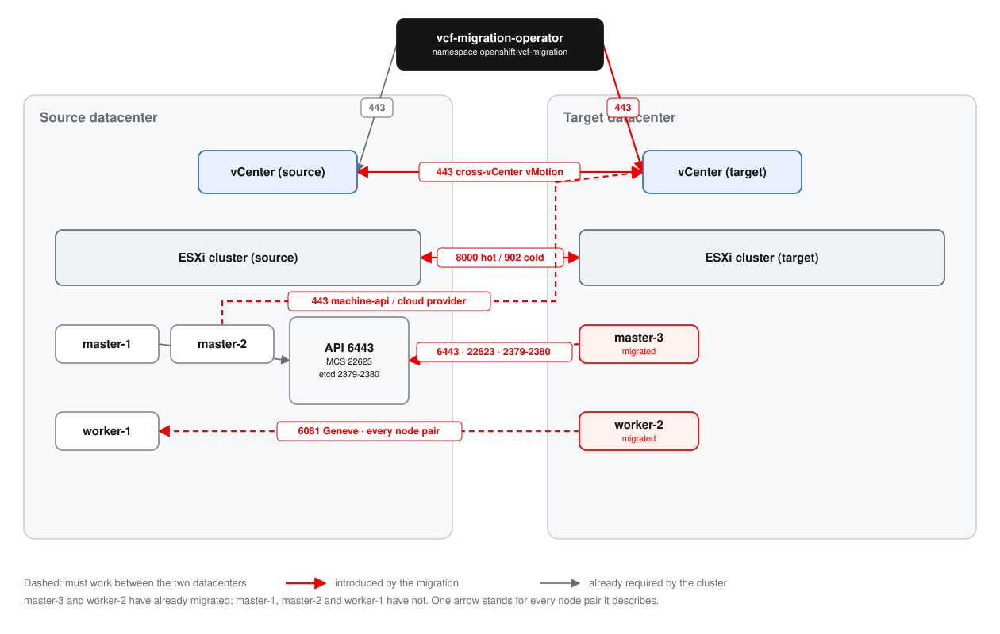

# Firewall and Network Requirements

Open the rules that apply to your migration **before** you set `spec.state: Running`. Rules
that are opened mid-migration fail the node being migrated, not the migration object, so a
missing rule shows up as a machine that never becomes `Ready`. Section 4 applies only to
migrations that select `type: VMotion`. In this revision, selecting VMotion and setting
`state: Running` only freezes a plan: no node moves and VM-changing actions stay disabled.

This document covers a migration that is **partly complete**: some nodes already
run on the target vCenter while the rest still run on the source vCenter. Traffic
between those two halves is where most mid-migration failures come from.

- Editable diagram source: [`docs/assets/firewall-mid-migration.drawio`](../assets/firewall-mid-migration.drawio)
- Red arrows: traffic the migration introduces. Grey arrows: traffic the cluster already needs.
- A single arrow stands for **every** node pair it describes. The overlay is a full mesh.

## Assumptions

- The OpenShift cluster is installed on vSphere and uses **OVN-Kubernetes**. OpenShift SDN
  (VXLAN `4789/udp`) is not covered here.
- The source and target vCenters are in different vCenter SSO domains and different datacenters.
- **Destination networks must be in the same IPv4 subnet, with the same default gateway, as one
  of the networks your source nodes already use.** Preflight clones a probe VM onto each
  destination failure domain and fails with a `NetworkMismatch` event if it does not match a
  source node network. A routed target network on a different subnet fails preflight; design the
  target segment as the same subnet, stretched across the two datacenters if needed. Preflight
  probes only the **first** entry in each failure domain's `topology.networks` list; check any
  additional networks by hand.
- vCenter listens on the default **TCP 443**. If it does not, use the same rule with your port;
  the operator connects to the FQDN you configure.
- `spec.migrateStorage` is **false** and `spec.nodeMigration` is omitted or `Recreate`, so you
  have set the `managementState` of `ClusterCSIDriver/csi.vsphere.vmware.com` to `Removed`
  yourself. The operator does not remove the driver; preflight fails until the state is
  `Removed`. A `VMotion` selection skips this preflight check.
- With no VMotion selection, setting `spec.migrateStorage` to `true` gives you storage
  **planning only**: the workflow stops with `StorageExecutionUnsupported` before any storage
  execution, and section 2 does not enable it.

## Direction convention

Every rule is listed in the direction the connection is **initiated**. Stateful firewalls
permit the return traffic automatically. Where a flow runs in both directions (cross-vCenter
vMotion does), the table says so.

## 1. Operator to vCenter

The operator runs in the `openshift-vcf-migration` namespace and connects outward. Nothing
connects inward to the operator.

| Protocol | Port | Source | Destination | Purpose |
| --- | --- | --- | --- | --- |
| TCP | 443 | Operator pod | Source vCenter | vim25 SOAP session, inventory, tags, storage profiles, VM reads |
| TCP | 443 | Operator pod | Target vCenter | vim25 SOAP session, folders, tags, storage profiles, probe VM clone, Machine-set topology validation |

The operator never connects to an ESXi host directly. Every vSphere operation goes through a
vCenter.

## 2. Cluster components to vCenter

Before any node moves, the operator adds the target vCenter to the credentials secret, the
`Infrastructure` resource and the `cloud-provider-config` ConfigMap. From that moment the
cluster itself, not only the operator, talks to the target vCenter.

| Protocol | Port | Source | Destination | Purpose |
| --- | --- | --- | --- | --- |
| TCP | 443 | Control plane nodes (Machine API provider, cloud provider) | Target vCenter | Creating Machines on the target failure domains, then reconciling them |
| TCP | 443 | Each node | The vCenter hosting its own failure domain | Kubelet and cloud provider node lookups |
| TCP | 443 | Every node (`migrateStorage: true` only) | Both vCenters | vSphere CSI controller and node operations |

Missing the first row is the quietest failure in this document. If the Machine API provider
cannot reach the target vCenter, no VM appears in vCenter at all and the Machine reports a
creation error. If only the cloud provider is blocked, the VMs appear and the nodes never
become `Ready`.

## 3. vSphere hosts and vCenter

These rules are unchanged by the migration, but a migration tests them harder than steady
state, because new VMs are cloned and powered on during it.

| Protocol | Port | Source | Destination | Purpose |
| --- | --- | --- | --- | --- |
| TCP | 443 | ESXi host (source and target) | Own vCenter | Host management, host agent, guest tools reporting |
| TCP | 443 | Own vCenter | ESXi host (source and target) | Host management and configuration, including placement of a cloned VM |
| UDP | 902 | ESXi host (source and target) | Own vCenter | Host heartbeat and status |
| TCP | 902 | Own vCenter | ESXi host (source and target) | Provisioning and NFC traffic that vCenter drives during clone and power-on |
| TCP | 902 | ESXi host | ESXi host | Provisioning and NFC: template clone, disk copy, cold relocation |
| TCP | 443 | ESXi host | ESXi host | Host-to-host migration and provisioning |

## 4. Cross-vCenter vMotion

Required when `spec.nodeMigration.<workers|controlPlane>.type: VMotion`. A Recreate migration
does not move a VM between datacenters, so it does not need these rules.

| Protocol | Port | Source | Destination | Purpose |
| --- | --- | --- | --- | --- |
| TCP | 443 | Source vCenter | Target vCenter | Cross-vCenter relocation: both directions must be open |
| TCP | 8000 | Source ESXi host | Target ESXi host | vMotion data path for a powered-on VM (`mode: Hot`), both directions |
| TCP | 902 | Target ESXi host | Source ESXi host | NFC transfer for a powered-off VM (`mode: Cold`), both directions |
| TCP | 443 | Source or target ESXi host | Peer ESXi host | Host-to-host preparation of the relocation, both directions |

`8000` carries the guest memory image. Throughput on that path, not just its existence, decides
how long a Hot migration takes.

## 5. Cluster traffic between the two datacenters

These are the rules that a partly migrated cluster needs and a fully migrated one does not.
Apply them to **every pair of nodes**, whichever datacenter each node is in: OVN-Kubernetes
builds a Geneve tunnel between every node and every other node, not only between nodes whose
pods happen to talk. The control plane keeps one etcd cluster and one API, so those flows are
every-pair within the control plane too.

If both datacenters are on the same stretched subnet, a firewall between them still sees this
traffic and must permit it.

| Protocol | Port | Source | Destination | Purpose |
| --- | --- | --- | --- | --- |
| TCP | 6443 | Every node | Control plane nodes | Kubernetes API |
| TCP | 22623 | Every node | Control plane nodes | Machine Config Server, used on every node boot and rollout |
| TCP | 2379-2380 | Every control plane node | Every control plane node | etcd server and peer traffic, full mesh across the control plane |
| TCP | 10250-10259 | Every node | Every node | Reserved Kubernetes ports, kubelet and aggregated API |
| UDP | 6081 | Every node | Every node | OVN-Kubernetes Geneve overlay: full mesh, every pair, pod traffic and overlay control |
| TCP and UDP | 9000-9999 | Every node | Every node | Host-level services, including node exporter and Cluster Version Operator |
| ICMP | n/a | Every node | Every node | Reachability checks |

Control plane nodes split across datacenters keep a single etcd cluster, so `2379-2380` must
work between the migrated control plane node and both of the others. With three control plane
nodes, isolating one of them (master-3 in the diagram) leaves master-1 and master-2 with
quorum, so the API keeps serving from the source side. The API stops serving only when a
partition leaves no quorum on the side that has to serve. Losing quorum is transient and
recovers as soon as connectivity returns, but it is still the failure to design against: it
happens mid-rollout, while the operator keeps moving nodes and the surviving side keeps
shrinking.

If you use `NodePort` services, also open `30000-32767` TCP and UDP between the two networks.
If you enabled IPsec, open ESP plus UDP `500` and `4500`.

## 6. Infrastructure services

New VMs on the target network have no cluster configuration until they reach these services.

| Protocol | Port | Source | Destination | Purpose |
| --- | --- | --- | --- | --- |
| TCP and UDP | 53 | Every node and the preflight probe VM | DNS servers | Cluster DNS records, including reverse records |
| UDP | 67/68 | Preflight probe VM and new nodes | DHCP server | Address assignment on the target network |
| UDP | 123 | Every node and ESXi host | NTP servers | Clock sync; etcd rejects a node whose clock drifts |
| TCP | 443 | Every node | Image registry or mirror | Image pulls for new nodes |
| TCP | Proxy port from the configured proxy URL (443 by default) | Every node | HTTP proxy | Egress for cluster components |

The **preflight probe VM** is cloned from `topology.template` onto the destination network and
powered on before any node moves. It must obtain an address through DHCP — a static
configuration is not configurable in this release — and report it through open-vm-tools. If it
does not, preflight fails before migration starts, which is the intended behaviour.

The probe runs only when `spec.nodeMigration` is omitted or `type: Recreate`. A VMotion
selection skips it, so a VMotion migration gets no network compatibility check from the
operator. Verify the rules in section 5 by hand in that case.

## Verify before the first migration

No cluster node exists on the target yet, so check the destination side from a temporary test
VM on each destination network that runs a known listener. Each command must succeed before
you set `state: Running`.

1. From a control plane node on the source side: `nc -vz <source-vcenter-fqdn> 443` and `nc -vz <target-vcenter-fqdn> 443`.
2. From that same node: `nc -vz <test-vm-target-ip> 6443` and `nc -vz <test-vm-target-ip> 10250`.
3. From the target test VM: `nc -vz <source-control-plane-ip> 6443`. Firewalls are often asymmetric, so test the return direction too.
4. Overlay delivery: start a UDP listener on the test VM and send from a source node to `<test-vm-target-ip>:6081`, in both directions, capturing packets on each side. `nc -vzu` proves nothing on UDP: success only means no ICMP unreachable came back.
5. `ping <test-vm-target-ip>`, to confirm ICMP is not filtered.

## Verify after the first nodes have moved

1. From a control plane node on the source side: `nc -vz <migrated-control-plane-ip> 6443`.
2. From a source-side node: `nc -vz <migrated-node-ip> 10250`, where `<migrated-node-ip>` is any node that has already moved.
3. From a source-side control plane node: `nc -vz <migrated-control-plane-ip> 2379`.
4. Repeat the UDP listener and packet capture test between a source-side node and a migrated node, in both directions.

## What a missing rule looks like

| Missing rule | Symptom |
| --- | --- |
| Operator to target vCenter `443` | Preflight fails with a vCenter login or inventory error; nothing is created |
| Cluster to target vCenter `443` | No VM is created at all, or VMs are created and the nodes never become `Ready` |
| ESXi to ESXi `902` | New machines stay in `Provisioning`; the clone task never completes |
| vCenter to ESXi `902` | The clone or power-on task stalls and the new VM never powers on |
| Cross-vCenter `443` | VMotion fails to start with a connection error to the target vCenter |
| ESXi to ESXi `8000` | Hot migration starts and then times out moving the memory image |
| `2379-2380` between control plane nodes | etcd loses quorum on the serving side; the API stops responding until quorum returns |
| `6081/udp` between datacenters | Nodes are `Ready` but pods on one side cannot reach pods on the other |
| `22623` from the target network | New nodes never fetch their machine config and stay `NotReady` |

## Sources

- [Ports used for all-machine to all-machine communications](https://docs.okd.io/4.18/installing/installing_bare_metal/upi/installing-bare-metal-network-customizations.html) — cluster port table.
- [TCP and UDP ports required to access ESXi](https://knowledge.broadcom.com/external/article/319455) — `443`, `902` host-to-host migration and provisioning.
- [Cross vCenter Server export with Advanced Cross vCenter vMotion](https://knowledge.broadcom.com/external/article/418117) — `443` between vCenters, `8000` and `902` on the hosts.
- `internal/controller/preflight_netcheck.go` — probe VM subnet and gateway match, Recreate only.
- `internal/controller/storage_planning.go` — CSI management state when `migrateStorage` is set.
